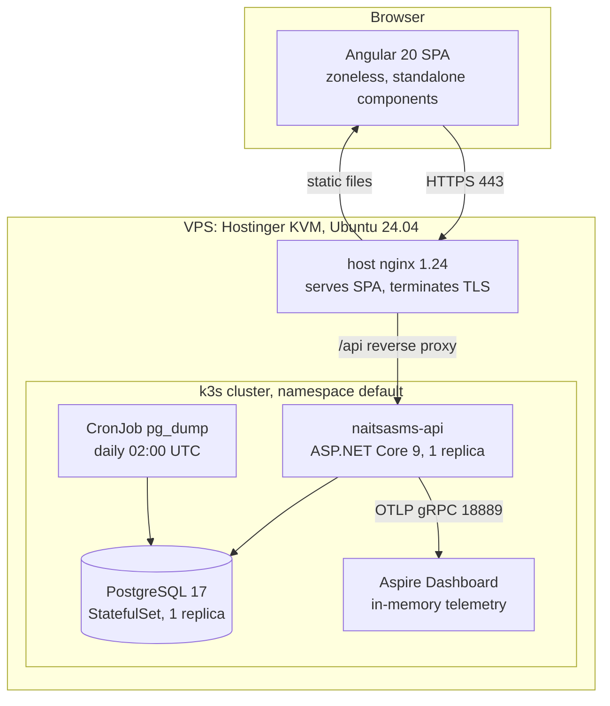
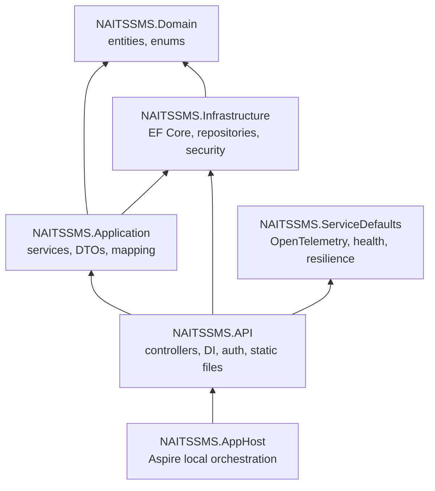
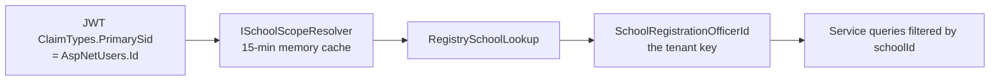

# NAITS-ASMS — Software Design Document

**System:** NAITS Academic & School Management System (NAITS-ASMS)
**Live platform:** <https://ourschoolonline.ng>
**Repository:** `NAITSSMS_CLOUD_CLOUD_NATIVE`, branch `cloud-native`
**Audience:** Software engineers joining or maintaining this codebase.

---

## 1. About this document

This document describes how the system is actually built today, not how it ideally would be. Where
the implementation deviates from a textbook pattern, the deviation is documented along with the
reason, because several of those deviations are load-bearing and will break production if
"corrected" carelessly.

Two conventions are used throughout:

- **Fact** — verified by reading the code.
- **Inference** — a reasonable conclusion that is not explicitly stated anywhere in the code.

Read [section 4.5 (TimeStatus)](#45-timestatus--the-soft-versioning-rule), [section 4.7 (schema
evolution)](#47-schema-evolution--why-production-does-not-run-migrations) and
[section 4.10 (multi-tenancy)](#410-multi-tenancy--how-a-request-is-scoped-to-a-school) before
writing any query or migration. Those three sections cover the constraints most likely to cause
data corruption or a cross-tenant data leak.

---

## 2. What the system does

NAITS-ASMS is a multi-tenant school management platform. Each tenant is a school (referred to as a
**learning centre** in the Almajiri programme context). The platform covers the full academic
administration lifecycle:

| Capability | Summary |
| --- | --- |
| School onboarding | Public self-registration of a school and its registrar; licensing/subscription per school |
| People | Students (learners), employees (facilitators/teachers), school heads, accountants, agents |
| Academic structure | Sessions → terms, classes → arms, subject categories → subjects, teacher assignments |
| Assessment | Continuous assessment (CA1–CA3) and exam scores, affective and psychomotor traits |
| Results | Report cards, broadsheets, class positions, promotion between classes |
| Attendance | Term attendance totals (legacy) plus a per-day register for learners and facilitators |
| Finance | Fee schedules, fixed and optional charges, discounts, payments, payroll |
| SMS | Balance, purchase and send, with a legacy HTTP gateway for external callers |
| Oversight | A Commission-level role that reads aggregated figures across all centres |
| CBT | Question banks and question setting (partially migrated) |

### 2.1 Roles

Roles are ASP.NET Identity roles carried in the JWT as `ClaimTypes.Role`.

| Role | Scope | Purpose |
| --- | --- | --- |
| `Registry` | One school | School administrator; the primary day-to-day operator |
| `Teacher` | One school | Subject scoring; form-master duties when assigned an arm |
| `CbtTeacher` | One school | Computer-based test question authoring |
| `Accounting` | One school | Fees and finance |
| `StudentOrParent` | One student | Self-service portal: profile, subjects, results |
| `SAOfficer` | Platform-wide | Super admin / Commission oversight across all schools |
| `HeadAdmin`, `Admin` | Platform-wide | User administration endpoints on `api/User` |
| `LocalAgents`, `RemoteAgents` | Reseller | Attribution of school onboarding to an agent |

**Fact:** The role seeding block in `DbSeeder.cs` is commented out. Roles such as `Teacher` and
`Accounting` are created on demand with `RoleManager.CreateAsync`. Do not assume every role exists in
a fresh database.

**Fact:** In `UserRegistrationController`, the `AddToRoleAsync(user, "Registry")` call inside
`create-school-registrar` is commented out. A newly self-registered school registrar may therefore
have no `Registry` role until it is assigned by another path.

### 2.2 Lineage

This is the second generation of the product. The first generation is a .NET Framework ASP.NET MVC
application present in the working tree at `NaitsSMS/SMS.sln` (projects `Common`, `Model`, `Services`,
`SMS.Presentation.Web`, `SMS.Tests`). It has its own `.git` directory and is **gitignored** by this
repository (`.gitignore` line 4), so you will only have it if you obtained it separately. It is not
built or deployed, but it explains most of the odd shapes in the current system:

- Table and column names come from the legacy database, which is still restored into production.
- Entity class names carry legacy infixes (`Tx`, `Rx`, `Xy`, `Ty`) that mean nothing today.
- Report card and broadsheet layout logic is a deliberate line-by-line port of Razor views.
- Some namespaces are still `CustRewardMgtSys.*` from an unrelated template project.

Feature migration is incomplete by design; unmigrated screens render placeholder components rather
than being hidden.

---

## 3. Architecture overview

### 3.1 Component view



**Fact:** The Angular UI is **not** part of `NaitsAsmsManifest.yaml`. It is served by host nginx from
a directory on disk and deployed by copying build output there.

**Inference:** Host nginx reverse-proxies `/api` to the API NodePort (30092). The exact live nginx
site config is not in the repository.

### 3.2 Backend layering



### 3.3 Scale

Measured on the working tree, excluding `bin`, `obj`, backup and scratch folders.

| Component | Files | Lines |
| --- | --: | --: |
| `NAITSSMS.Application` | 133 | 21,441 |
| `NAITSSMS.Infrastructure` | 22 | 17,689 (14,789 of which are generated migrations) |
| `NAITSSMS.API` | 23 | 10,323 |
| `NAITSSMS.Domain` | 65 | 2,386 |
| `NAITSSMS.ServiceDefaults` | 1 | 117 |
| `NAITSSMS.AppHost` | 1 | 34 |
| Frontend TypeScript | 203 | 29,491 |
| Frontend HTML | 77 | 9,126 |
| Frontend SCSS | 106 | 13,139 |

Largest single files, useful as a warning about where complexity concentrates:

| Lines / size | File |
| --- | --- |
| 3,096 | `NAITSSMS.API/Controllers/Api/RegistryController.cs` |
| 3,058 | `NAITSSMS.Application/Service/TeachersAndOthersService.cs` |
| 1,863 | `NAITSSMS.Application/Service/RegistrationService.SuperAdmin.cs` |
| 6,731 (9 files) | all `RegistrationService*.cs` partials combined |
| 1,055 | `routes/admin/student-home-page/student-home-page.ts` |
| 774 | `routes/admin/student-results/student-results-report.builder.ts` |

Two very large files at the repository root — `RegistryLegacyController.cs` (901 KB) and
`RegistrationServiceJan2026.cs` (877 KB) — are **dead code** outside the solution build. Ignore them.

---

## 4. Backend design

### 4.1 Projects

| Project | Responsibility | References |
| --- | --- | --- |
| `NAITSSMS.Domain` | Entities, enums, `Entity`/`AuditableEntity` base types, `ApplicationUser` | none |
| `NAITSSMS.Infrastructure` | `AppDbContext`, migrations, `GenericRepository`, `UnitOfWork`, seeders, `SchemaRepair`, legacy security helpers | Domain |
| `NAITSSMS.Application` | Application services, DTOs, AutoMapper profiles, JWT config | Domain, Infrastructure |
| `NAITSSMS.API` | Controllers, composition root, authentication, static files | Application, Infrastructure, ServiceDefaults |
| `NAITSSMS.ServiceDefaults` | Aspire defaults: OpenTelemetry, health checks, HTTP resilience, service discovery | none |
| `NAITSSMS.AppHost` | Aspire orchestration for local development | API |

`NAITSSMS.Web` exists on disk as an untouched ASP.NET MVC scaffold. It is **not** in the solution and
is referenced by nothing. Treat it as removable.

#### Known layering deviations

1. **Application references Infrastructure directly.** Services consume
   `NAITSSMS.Infrastructure.Repo` and `NAITSSMS.Infrastructure.Unitofwork` concretely rather than
   through Domain-owned abstractions. Inverting this would touch every service; it is accepted debt.
2. **`IGenericRepository` is misfiled.** The file lives at `NAITSSMS.Domain/IRepository/IGenericRepository.cs`
   but declares namespace `NAITSSMS.Infrastructure.Repo`. Follow the namespace, not the folder.
3. **Legacy namespaces persist.** `AppDbContext` is in `CustRewardMgtSys.Infrastructure.Data`;
   `UserController` is in `CustRewardMgtSys.API.Controllers`. These are cosmetic but surprising.

### 4.2 Startup pipeline

`NAITSSMS.API/Program.cs` is the composition root. All DI registration is manual — there is no
assembly-scanning convention to discover.

Service registration order: Aspire service defaults → controllers with camelCase JSON and cycle
handling → Swagger (Development only) → memory cache → `AddNpgsqlDbContext<AppDbContext>` (with
`DisableHealthChecks = true`) → Identity with token providers → lockout options from
`LoginProtection:*` → JWT bearer → AutoMapper → ~16 application services → `IHttpContextAccessor` →
CORS policy `naitsPortalUi`.

Middleware order after `app.Build()`:

1. `MapDefaultEndpoints()` — `/health` and `/alive`
2. Environment branch: Development runs `DbSeeder.SeedAsync` (migrate + repair) and Swagger;
   otherwise `SchemaRepair.ApplyAsync` inside a try/catch that logs and continues
3. Middleware that swallows `OperationCanceledException` for aborted clients and health probes
4. `UseCors` — deliberately **before** HTTPS redirection so preflight succeeds
5. `UseHttpsRedirection`
6. Middleware setting `Cache-Control: no-store` for `/api`, `/home`, `/user`, `/health`
7. Middleware rewriting legacy media paths, with case-insensitive file lookup for Linux
8. `UseStaticFiles` → `UseAuthentication` → `UseAuthorization` → `MapControllers`

**Fact:** There is no global exception handler. Each controller does its own try/catch.

CORS policy `naitsPortalUi` allows credentials from `http://localhost:4209`,
`https://ourschoolonline.ng`, and `http://82.29.173.232:30888`.

A CLI path exists: `dotnet run -- --seed-almajiri` runs the demo seeder and exits before the web host
starts.

### 4.3 Service layer

Convention: interfaces in `NAITSSMS.Application/IService/`, implementations in
`NAITSSMS.Application/Service/`, DTOs flat in `DTOs/`, AutoMapper profile in `Mappings/`.

Sixteen application services are registered scoped; `ILoginThrottleService` and
`ITwoFactorLoginTicketService` are singletons.

`RegistrationService` is one class split across nine partial files. The constructor and shared
dependencies live in the core file.

| File | Lines | Covers |
| --- | --: | --- |
| `RegistrationService.cs` | 1,333 | Constructor, school scope helpers, promotion, assessment prep, school head, dashboard summary |
| `RegistrationService.SuperAdmin.cs` | 1,863 | School list/search, enable/disable, commission oversight, accountant creation, licensing admin |
| `RegistrationService.NewAssessment.cs` | 1,134 | Assessment processing and environment preparation |
| `RegistrationService.TeacherLinkedPages.cs` | 849 | Teacher subject and class-arm assignment pages |
| `RegistrationService.StudentResults.cs` | 588 | Student results orchestration |
| `RegistrationService.BroadSheet.cs` | 429 | Broadsheet generation |
| `RegistrationService.SmsGateway.cs` | 321 | Legacy `/home/*` SMS gateway algorithms |
| `RegistrationService.TeacherIndex.cs` | 184 | Teacher listing and index pages |
| `RegistrationService2nd.cs` | 30 | Empty stub, separate class, **not registered in DI** |

### 4.4 Domain model

Roughly 65 entity classes across 58 files, grouped by subject area:

- **School / organisation** — `SchoolTyInfo`, `SchoolRegistrationOfficer`, `SchoolLevelCategoriesLabel`, `SchoolHeadTx`, `SchoolHeadTxCategory`, `ProgramYInfo`, `Region`/`State`/`LocalGovernment`, `ContinuousAssessmentType`
- **People** — `ApplicationUser`, `TxStudentDetail`, `TxEmployee`, `TxEmployeeIncomeStructure`, `Agent`
- **Academic structure** — `TxAcademicSession`, `TxYearlyAndTermlyStatus`, `Term`, `TxYear`/`TxMonth`, `RxClasss`, `AxClassArm`, `SubjectRxCategories`, `RxSubject`, `TeachTxerSubjectArmAssignment`, `TeacherClassArmTxAssignment`, `SubjectStudentTxAssignment`, `StudentAcademicTxProgressHistory`
- **Assessment** — `StudenXtAccessment`, `AffectiveXzAndPsychomotor`, `AffectiveAndPsychomoTxtorAssessment`, `StudentsAtteXzndanceAndCommentsReport`
- **Attendance** — `LearnerDailyAttendance`, `FacilitatorDailyAttendance`
- **Finance** — `SetSchoolFeesTr`, `StudentTyTermlyFeePayment`, `StudentTyTermlyFixedPaymentDiscount`, `XyOPtionalChargeCategory`, `OptionalXyChargeItems`, `StudentOPtionalChargesAssignment`, `StudentTermlyOptionalCharges`, `StudentTermlyOptionalPayment`, `XyIncome*`/`XyExpense*`, `SetEmployeeSalary`, `TxEmployeesMonthlyPayment`
- **SMS** — `SmsPaymentBalance`, `SmsPurchase`, `SmsUsed`, `SmsLog`
- **CBT** — `CbtQuestionAndAnswer`, `CbtSetQuestion`
- **Licensing** — `LicensTying`, `ProgramYInfo`

Five entity classes are defined but have no `DbSet` and are effectively dead: `Address`,
`PaintCategory`, `SentSmsHistory`, `Subscriber`, `SystemsInfo`.

`Enum.cs` contains roughly 50 enums, almost all `: byte`, persisted as `smallint`. There are **no**
EF value converters — enum values are raw integers in the database.

#### The school primary key

**Fact:** `SchoolTyInfo`'s primary key is `SchoolRegistrationOfficerId` — the school row is keyed by
its registrar's user id, not by an independent school id. Foreign keys elsewhere are variously named
`SchoolInfoId`, `SchoolId` or `SchoolSmsId` but all hold this same value. This is the single most
confusing aspect of the schema.

### 4.5 `TimeStatus` — the soft-versioning rule

`TimeStatus` is an application-level versioning flag, **not** EF temporal tables and not a soft-delete
flag:

```csharp
public enum TimeStatus : byte { Current, Previous }   // Current = 0, Previous = 1
```

When a logical record is superseded, the existing row is set to `Previous` and a new `Current` row is
inserted. Both rows remain in the table forever.

Entities carrying it (as `TimeStatus`, or as `Status` on two of them):

| Property name | Entities |
| --- | --- |
| `TimeStatus` | `TxStudentDetail`, `TxEmployee`, `RxSubject`, `Agent`, `SchoolRegistrationOfficer`, `LicensTying`, `SmsPurchase`, `SetEmployeeSalary`, `XyIncomeWeek`, `XyExpenditureWeek` |
| `Status` | `SchoolHeadTx`, `TxAcademicSession` |

**The rule: every operational query must filter `TimeStatus == TimeStatus.Current`** (or
`Status == TimeStatus.Current`) unless it is deliberately reading history. Omitting the filter returns
the same logical entity multiple times, which silently corrupts counts, dashboards, enrolment
figures and assignment lists.

Worked example from licensing, where issuing a new licence demotes the old ones:

```csharp
var currentLicenses = await licenseRepo.WhereAsync(
    x => x.SchoolSmsId == model.SchoolSmsId && x.TimeStatus == TimeStatus.Current, ct);
foreach (var each in currentLicenses)
{
    each.TimeStatus = TimeStatus.Previous;
    licenseRepo.Update(each);
}
```

Do not confuse `TimeStatus` with two similarly-named but unrelated enums:

- `TermlyAccessmentStatus` (`Current`, `ResultProccessing`, `Previous`) — the term workflow state on `TxYearlyAndTermlyStatus`.
- `StudentStatus` (`Fresher`, `Returning`, `Previous`) — a student's promotion state.

### 4.6 Persistence

`AppDbContext` exposes 57 `DbSet` properties plus the Identity tables. `SaveChanges` is overridden to
stamp `IAuditableEntity` fields (`CreatedBy`, `CreatedDate`, `UpdatedBy`, `UpdatedDate`).

`OnModelCreating` configures Identity field lengths and unique indexes, several one-to-one
relationships that share a primary key, composite indexes on the assessment and attendance tables,
and maps `AttendanceDate` to PostgreSQL `date` (not `timestamptz`) so the unique-per-day index is
exact.

#### Entity to table mapping

DbSet property names and table names frequently differ from the entity class name. This table is the
one you will need most often:

| Entity class | DbSet property | Table |
| --- | --- | --- |
| `SchoolTyInfo` | `SchoolInfos` | `SchoolInfos` |
| `TxStudentDetail` | `StudentsDetails` | `StudentsDetails` |
| `TxEmployee` | `ClassTeachers` | `ClassTeachers` |
| `RxClasss` | `Classes` | `Classes` |
| `AxClassArm` | `ClassArms` | `ClassArms` |
| `RxSubject` | `Subjects` | `Subjects` |
| `SubjectRxCategories` | `SubjectCategories` | `SubjectCategories` |
| `StudenXtAccessment` | `StudentAccessments` | `StudentAccessments` |
| `StudentsAtteXzndanceAndCommentsReport` | `StudentsAttendanceReports` | `StudentsAttendanceReports` |
| `SchoolHeadTx` | `PrincipalDetails` | `PrincipalDetails` |
| `TxYearlyAndTermlyStatus` | `YearlyAndTermlyAssessmentStatus` | `YearlyAndTermlyAssessmentStatus` |
| `TxAcademicSession` | `AcademicSessions` | `AcademicSessions` |
| `SetSchoolFeesTr` | `SetFreshierRegistrationFees` | `SetFreshierRegistrationFees` |
| `StudentTyTermlyFixedPaymentDiscount` | `FeePaymentDiscounts` | `FeePaymentDiscounts` |
| `LicensTying` | `Licensings` | `Licensings` |
| `XyIncomeCategory` | `IncomeCategorys` | `IncomeCategorys` (typo preserved deliberately) |
| `LearnerDailyAttendance` | `LearnerDailyAttendances` | `LearnerDailyAttendances` |
| `FacilitatorDailyAttendance` | `FacilitatorDailyAttendances` | `FacilitatorDailyAttendances` |

Notably, `TxEmployee` maps to a table called `ClassTeachers` even though it represents all employees,
including non-teaching staff.

#### Repository and unit of work

Services never touch `AppDbContext` directly; they go through `IUnitOfWork`:

```csharp
var repo = _uow.Repository<TxStudentDetail>();          // string key by default
var rows = await repo.WhereAsync(
    s => s.TimeStatus == TimeStatus.Current && s.SchoolInfoId == schoolId, ct);
repo.Update(entity);
await _uow.SaveChangesAsync(ct);
await _uow.ExecuteInTransactionAsync(async () => { /* ... */ });
```

Read methods (`FindAsync`, `GetAllAsync`, `WhereAsync`, `CountAsync`, `SelectWhereAsync`,
`MaxOrDefaultAsync`) use `AsNoTracking`. `Update` merges into an already-tracked instance by primary
key to avoid duplicate-key tracking conflicts, and marks only the entity modified without attaching
navigations. `Delete` is a hard delete. Repositories are cached per `UnitOfWork` instance and share
one `AppDbContext`. The synchronous transaction APIs are marked `[Obsolete]`.

### 4.7 Schema evolution — why production does not run migrations

This is the most important operational constraint in the system.

There are four migrations:

| Migration | Purpose |
| --- | --- |
| `20260507104000_Initial` | Full schema bootstrap, 63 `CreateTable` calls |
| `20260516154551_Initial2nd` | Makes several `AspNetUsers` columns nullable |
| `20260802213538_migratingToCloudeNative` | Subject category composite index changes |
| `20260811161630_AddDailyAttendanceRegister` | Daily attendance tables, written as idempotent SQL |

Production databases were **restored from the legacy system**, so their `__EFMigrationsHistory` does
not correspond to this project's migration list. Running `Database.Migrate()` there would attempt
DDL that already exists, or apply changes in the wrong order.

The system therefore has two schema paths:

| Environment | Behaviour |
| --- | --- |
| Development | `DbSeeder.SeedAsync` runs `Database.MigrateAsync()` then `SchemaRepair.ApplyAsync` |
| Production | **No migrations.** Only `SchemaRepair.ApplyAsync`, wrapped in try/catch so a failure cannot stop the API from serving |

`SchemaRepair.cs` contains hand-written idempotent DDL, currently two operations:

1. `ApplyClassTeachersIdRepairAsync` — adds an `Id` primary key column to `ClassTeachers` if missing,
   backfilling from `UserId`, because legacy databases keyed that table differently.
2. `ApplyDailyAttendanceTablesAsync` — `CREATE TABLE IF NOT EXISTS` plus indexes for the two daily
   attendance tables, matching the migration exactly.

**Rule for adding schema in production:** write the change twice — once as an EF migration for
development, and once as idempotent DDL in `SchemaRepair` (`CREATE TABLE IF NOT EXISTS`,
`CREATE INDEX IF NOT EXISTS`, or a `DO $$ ... $$` block guarded by an `information_schema` check).
Never put a destructive statement in `SchemaRepair`; it runs on every single startup.

### 4.8 Other infrastructure plumbing

| File | Purpose |
| --- | --- |
| `Data/Security/FreePlugIn.cs` | Legacy TripleDES encrypt/decrypt with a fixed seed for compatibility with legacy data; hardware fingerprint via WMI on Windows or DMI/`machine-id` on Linux, overridable with `NAITS_UNIQUE_SYSTEM_ID`; licence token generation |
| `Data/Security/LegacyJsonDate.cs` | Reads and writes Microsoft-format `\/Date(ms)\/` JSON dates via Newtonsoft, because legacy credential and licence records store dates that way and `System.Text.Json` cannot parse them |
| `Data/DbSeeder.cs` | Development startup: migrate plus repair. Its large reference-data seeding block is commented out |
| `Data/AlmajiriDemoSeeder.cs` | Deterministic idempotent demo dataset: 6 centres, learners, facilitators, subjects, term scores, ~60 days of attendance |

`NAITS_UNIQUE_SYSTEM_ID` must stay identical across API replicas, otherwise licence binding breaks.
It is set to `ourschoolonline-vps-01` in the Kubernetes ConfigMap.

### 4.9 HTTP API surface

Fourteen controllers. Route prefixes are `api/{Controller}` except the legacy `home` gateway.

| Controller | Prefix | Endpoints | Class-level auth |
| --- | --- | --: | --- |
| `RegistryController` | `api/Registry` | 90 | `[Authorize]` |
| `TeachersAndOthersServiceController` | `api/TeachersAndOthersService` | 61 | **none** |
| `SuperAdminController` | `api/SuperAdmin` | 24 | `[Authorize(Roles="SAOfficer")]` |
| `StudentController` | `api/student` | 18 | `[Authorize]` |
| `UserRegistrationController` | `api/user-registration` | 17 | `[Authorize]` + one anonymous |
| `SubjectController` | `api/Subject` | 16 | `[Authorize]` |
| `UserController` | `api/User` | 14 | mixed |
| `StudentPortalController` | `api/StudentPortal` | 11 | `[Authorize]` |
| `SessionAndTermController` | `api/SessionAndTerm` | 10 | **none** |
| `HomeController` | `home` | 8 | `[AllowAnonymous]` (legacy SMS gateway) |
| `ClassAndArmController` | `api/ClassAndArm` | 6 | `[Authorize]` |
| `RegistryOtherMethodController` | `api/RegistryOtherMethod` | 2 | `[Authorize]` |
| `EmailController` | `api/Email` | 1 | `[Authorize]` |
| `WeatherForecastController` | `WeatherForecast` | 1 | none (template scaffold) |

`RegistryController` is the school-admin hub, grouped roughly as: landing/licence gate, teachers and
assignments, CBT users, promotion, subscription, dashboard summary, school heads, school setup,
assessment configuration, term attendance totals, daily attendance, electives, term revert, student
results and broadsheets, SMS, and system migration.

#### Newest features

**Daily attendance** (`api/Registry/daily-attendance/*`, backed by `DailyAttendanceService`):

| Verb | Route | Purpose |
| --- | --- | --- |
| GET | `daily-attendance/learners?armId=&date=` | Roster for one arm on one date |
| POST | `daily-attendance/learners` | Save learner marks |
| GET | `daily-attendance/facilitators?date=` | Staff roster |
| POST | `daily-attendance/facilitators` | Save facilitator marks |
| GET | `daily-attendance/summary?from=&to=` | Centre summary, at-risk learners, trend (default last 30 days) |
| POST | `daily-attendance/sync-term-totals` | Roll daily marks into the legacy term attendance table |

Business rules: future dates are rejected; a current or result-processing term must exist; learner
marks are scoped to arm and school; `Late` and `Excused` both count as present for rate calculations;
a learner is "at risk" at three consecutive absences or a rate below 60% over the window.

**Commission oversight** (`api/SuperAdmin`, SAOfficer only):

| Verb | Route | Purpose |
| --- | --- | --- |
| GET | `dashboard/commission/centres` | Centre directory with learner and facilitator counts, no attendance aggregation |
| GET | `dashboard/commission?from=&to=` | Full oversight: programme totals, today's rates, period rates, per-centre rows with `NeverSubmitted` and `RegisterOverdue` flags, daily trend and enrolment series |

The directory endpoint exists separately so the default dashboard view avoids the expensive
attendance aggregation. A register is "overdue" after three days without submission.

#### DTOs and mapping

About 83 DTO files, flat in `NAITSSMS.Application/DTOs/`, with no bounded-context subfolders. Newer
ones are `sealed class` with XML docs; naming is either entity-aligned (`StudentDetailsDto`), a
feature bundle holding several types (`DailyAttendanceDto.cs`, `CommissionOversightDto.cs`), or a
request/result pair. AutoMapper handles the straightforward entity-to-DTO cases via
`Mappings/MappingProfile.cs`; a great deal of mapping is still manual, especially in the legacy
ports. Multipart form endpoints use request models in `NAITSSMS.API/Models/` instead.

JSON is global camelCase, except `TokenDto` which uses explicit `[JsonPropertyName]` for an
OAuth-style `access_token` shape.

#### Response conventions

Conventions are inconsistent, a direct consequence of incremental migration. Expect all of these:

| Shape | Where |
| --- | --- |
| `{ Status, Data }` | Login, some registration endpoints |
| `{ message }` or `{ message, detail }` | Newer Registry and SuperAdmin endpoints |
| Legacy status integers | e.g. `UpdateSchoolRegistrarResultDto.Status` as a byte |
| Bare primitives | Some SuperAdmin legacy mirrors return `Ok(false)` |
| `ResponseDto` / `OutputBase` | Older service returns |

Some failures are returned as HTTP 200 with a failure flag in the body — notably login failures.
Newer endpoints use 400, 401, 404 and 500 properly, logging via `ILogger` before returning 500 with
`{ message = "An error occurred while..." }`. Cancellation tokens are accepted and propagated widely;
`HomeController.SmsBalance` deliberately uses `CancellationToken.None` because legacy gateway callers
abort mid-request.

### 4.10 Multi-tenancy — how a request is scoped to a school

**The tenant key is not in the JWT.** It is resolved per request.



`RegistrySchoolLookup.ResolveSchoolRegistrationOfficerIdAsync` tries, in order:

1. Direct match on `SchoolRegistrationOfficerId` or the officer's `UserId`
2. Officer record → linked school
3. Employee record → `employee.SchoolId`
4. **Fallback:** if exactly one school exists in the database, use it

That last fallback is convenient for single-tenant development and dangerous to rely on elsewhere.

For licensing checks, `SecurityService` resolves the school differently per role: `Registry` via the
registration officer, `Teacher`/`Accounting` via their employee record.

**Fact: there is no EF global query filter.** Isolation depends entirely on every service passing the
resolved `schoolId` into its `Where` clause. A query that forgets it will read across tenants and the
compiler will not complain. `RegistryController` also carries its own duplicate resolution helper,
`ResolveRegistrySchoolIdAsync`.

SAOfficer commission endpoints query across all schools intentionally.

### 4.11 Authentication and authorisation

**Authentication** is ASP.NET Identity for the user store plus JWT bearer for API calls.

The JWT secret is resolved by `JwtConfiguration.ResolveSecret` with this precedence, throwing at
startup if none is found: `JWT__Secret` env → `JWT_SECRET` env → `Parameters__JWT_SECRET` env →
`JWT:Secret` config → `Parameters:JWT_SECRET` config.

Claims issued: `ClaimTypes.Name`, `jti`, `ClaimTypes.PrimarySid` (the user id), and one
`ClaimTypes.Role` per role. Token validity is 120 minutes by default
(`JWT:TokenValidityInMinutes`).

**Fact: there are no refresh tokens.** `TokenDto` declares a `refresh_token` field that is never
populated, and no refresh endpoint exists. Clients must re-authenticate when the token expires. The
Angular `TokenService` nevertheless schedules a refresh call, which will fail.

Login flow: `POST /api/User/login` → throttling by IP and username (`ILoginThrottleService`) plus
Identity lockout (5 failures, 30 minutes by default) → if the user has 2FA enabled **and** holds one
of `SAOfficer`, `Registry`, `HeadAdmin`, `Admin`, return `RequiresTwoFactor` with a 5-minute
in-memory ticket → `POST /api/User/login-2fa` with the TOTP code → JWT.

**Authorisation** uses only `[Authorize]` and `[Authorize(Roles=...)]`. There are no authorisation
policies (`AddPolicy` is used only for CORS) and no global fallback policy, so any endpoint without
an attribute is anonymous.

Deliberately anonymous: login, 2FA completion, `create-school-registrar` (public school signup), the
eight `home/*` legacy gateway routes, and the template `WeatherForecast`.

**Security gaps worth knowing (facts, not recommendations already actioned):**

- `TeachersAndOthersServiceController` — 61 endpoints with no `[Authorize]`.
- `SessionAndTermController` — 10 endpoints with no `[Authorize]`; its `GetUserId()` throws
  `UnauthorizedAccessException`, which surfaces as a 500 rather than a 401.
- `GET /api/User/get-all-users` — no `[Authorize]`.
- Controllers with `[Authorize]` but no role restriction (`RegistryController` among them) are
  callable by *any* authenticated user, including a student. Role separation currently relies on the
  Angular UI not offering the navigation.

Feature-flag gating exists on the demo seeder: `POST /api/SuperAdmin/demo/seed-almajiri` returns 403
unless `Demo:AllowAlmajiriSeed` is true, and still requires an SAOfficer token.

Beyond ASP.NET authorisation there is a second, business-level gate: many Registry flows call
`SecurityService` / `SecurityExtensionService` to verify the school's subscription and licence state.

### 4.12 Cross-cutting concerns

| Concern | Implementation |
| --- | --- |
| Caching | `AddMemoryCache`; used by `SchoolScopeResolver` (15 min), `SubjectService`, `TeachersAndOthersService` |
| Background jobs | **None in process.** No `IHostedService`, Hangfire or Quartz. Backups run as a Kubernetes CronJob |
| Logging | `ILogger<T>` plus OpenTelemetry log export; production suppresses EF command logging |
| Licensing | `FreePlugIn` + `LicensTying`; trial versus full via an implementation-type flag |
| SMS | Inbound legacy gateway via `HomeController` → `RegistrationService.SmsGateway`; outbound via `NAITSSMS.API/Services/RegistrySmsService.cs`, which calls the Jusibe HTTP API with credentials **hard-coded in source** |
| File storage | `wwwroot/{Passport,Signatures,profile-avatars,school-logos}`; database stores filenames only, APIs return relative URLs |
| Legacy media URLs | Middleware rewrites `/Content/SchLogos/*`, `/uploads/*` and fixes filename casing on Linux |

Upload limits are enforced per endpoint; profile images are capped at 100 KB, JPG/PNG only.

---

## 5. Frontend design

### 5.1 Stack and tooling

Angular **20.3.10** with Angular Material **20.2.4**, built on the ng-matero template, bootstrapped
with `bootstrapApplication` and standalone components. Package manager is **Yarn 1.22** — `package.json`
declares npm unsupported, and `npm ci` fails because `package-lock.json` is out of sync with
`yarn.lock`.

Notable dependencies: `@ng-matero/extensions`, `@ngx-formly/core`, `@ngx-translate/core` v17,
`ngx-permissions` v19, `apexcharts` v5, `@ngxpert/hot-toast`, `date-fns`, `angular-in-memory-web-api`
(development only).

Path aliases: `@core`, `@shared`, `@theme`, `@env`, `@testing`. Strict mode and `strictTemplates` are
on.

Build configurations in `angular.json` (project name `ng-matero`, output `dist/ng-matero`):

| Configuration | Environment file | Notes |
| --- | --- | --- |
| `production` (default) | `environment.prod.ts` | Full optimisation, subresource integrity, output hashing |
| `offline` | `environment.offline.ts` | Same optimisation, no SRI, for the offline demo stack |
| `development` | `environment.ts` | Source maps, used by `ng serve` |

Budgets: initial bundle 2 MB warning / 5 MB error; **component styles 12 KB warning / 28 KB error**;
any single bundle 1 MB / 2.5 MB. The component-style ceiling was raised from 16 KB because
`admin/dashboard/dashboard.scss` legitimately exceeds it at roughly 22 KB.

### 5.2 URL configuration

Two separate concepts, easy to confuse:

| Property | Meaning | Development | Production | Offline |
| --- | --- | --- | --- | --- |
| `serverUrl` | Absolute API base used directly by `GenericService` and `LoginService` | `https://localhost:7049/api` | `https://ourschoolonline.ng/api` | `{page origin}/api` |
| `baseURL` | Injected as the `BASE_URL` token; `baseUrlInterceptor` prepends it only to **relative** URLs | `window.location.origin` | `window.location.origin` | `window.location.origin` |

Because most services call the absolute `serverUrl`, `BASE_URL` affects fewer requests than you would
expect.

**Known defect:** `proxy.config.js` proxies `/api` to `https://localhost:7045`, but the API's launch
profile and `environment.ts` both use **7049**. The dev proxy is therefore pointing at the wrong port.

### 5.3 Bootstrap and its resilience layers

```
index.html (#globalLoader splash)
  → main.ts (bootstrapApplication)
    → app.config.ts (providers, app initializers)
      → App (app-root, router-outlet)
```

Providers of note, in order: browser error listeners → **`provideZonelessChangeDetection()`** →
`BASE_URL` → `provideAppInitializer(TranslateLangService.load)` → `provideAppInitializer(StartupService.load)`
→ HTTP client with the interceptor chain → router (in-memory scrolling, component input binding) →
hot-toast → translate with HTTP loader → `NgxPermissionsModule.forRoot()` → in-memory web API
(development only) → Formly → Material paginator i18n and date adapters.

The application is **zoneless**. Change detection is not triggered automatically after HTTP
completion, which is why `BaseComponent` calls `cdr.markForCheck()` explicitly.

Bootstrap was hardened after a bug where a hard refresh of `/auth/login` could leave the splash
screen up forever. Five independent guards now exist:

| Layer | Guard | Protects against |
| --- | --- | --- |
| `PreloaderService.hide()` | 800 ms fallback if `transitionend` never fires | Splash stuck after bfcache restore or a skipped CSS transition |
| `App` constructor | Hard 6 s timeout hiding the preloader | Bootstrap stalling entirely |
| `TranslateLangService.load()` | 4 s timeout, always resolves | A missing or hanging i18n JSON file |
| `StartupService.load()` | 4 s `timeout` + `catchError` | A hanging `/user` call blocking app init |
| `AuthService.refreshUser()` | 4 s timeout, falls back to credential and JWT claims | A slow or unreachable profile endpoint |

The complementary server-side fix is nginx cache headers: the HTML shell must be `no-store` while
hashed assets are `immutable`, otherwise a hard refresh serves a stale `index.html` whose hashed
bundles no longer exist.

### 5.4 Core services

| Area | Contents |
| --- | --- |
| `core/authentication` | `AuthService` (session orchestration, user `BehaviorSubject`), `TokenService` (localStorage + refresh timer), `LoginService` (raw HTTP), `TokenFactory`, `authGuard` |
| `core/bootstrap` | `StartupService`, `MenuService`, `TranslateLangService`, `PreloaderService`, `SettingsService` |
| `core/interceptors` | Eight interceptors, see below |

**Two parallel credential stores exist**, which is a frequent source of confusion:

| Key | Written by | Contents | Read by |
| --- | --- | --- | --- |
| `ng-matero-token` | `TokenService` via `LocalStorageService` | JWT plus computed `exp` | `authGuard`, `tokenInterceptor` |
| `credential` | `Login` component and `AuthService.setUserCredential` | Plain JSON: token, expiration, `role[]`, `userFullName`, `userName` | `Sidemenu`, `StartupService` role resolution |

Role strings are normalised at login through `normalizeCredentialRoles` in
`shared/models/UserCredential.ts`, with helpers `credentialHasRole` (case-insensitive),
`isTeacherLikeRole` and `isStudentOrParentRole`.

`authGuard` checks **token validity only** — it does not check roles.

Interceptor chain, outside in:

| # | Interceptor | Behaviour |
| --- | --- | --- |
| 1 | `noopInterceptor` | Pass-through placeholder |
| 2 | `baseUrlInterceptor` | Prepends `BASE_URL` to non-absolute URLs |
| 3 | `settingsInterceptor` | Adds `Accept-Language` |
| 4 | `tokenInterceptor` | Adds `Authorization` and `withCredentials`; clears the token on 401 |
| 5 | `noCacheInterceptor` | GET API requests get no-cache headers plus a `_={timestamp}` cache-buster |
| 6 | `apiInterceptor` | Legacy ng-matero numeric `code !== 0` envelope handling |
| 7 | `errorInterceptor` | Toasts errors, redirects to login on 401, avoids SPA navigation on API 404/403/500 |
| 8 | `loggingInterceptor` | Development only request timing |

### 5.5 The `BaseComponent` / `withRequestState` pattern

This is the dominant async convention and the thing to imitate when adding a screen.
`shared/base.component.ts` provides `isLoading`, `errorMessage` and `isSubmitting` signals,
`showAlert()`, form validation helpers, and:

```typescript
protected withRequestState<T>(request$: Observable<T>, options?: RequestStateOptions): Observable<T>
```

It toggles the loading signal, clears or sets `errorMessage`, calls `cdr.markForCheck()` in
`finalize` (required because the app is zoneless), and either swallows or rethrows the error
depending on options (`useLoading`, `clearError`, `errorMessage`, `onError`, `notifyOnError`,
`rethrow`).

`GenericService` (`shared/services/generic.service.ts`) is the CRUD wrapper: `get`, `getAnObj`,
`create`, `update`, `delete`, `createWithFile`, `updateWithFile`. It sets JSON content type but does
**not** add the Authorization header — that is `tokenInterceptor`'s job.

### 5.6 Routing and role-based navigation

```
app.routes.ts
├── AdminLayout + authGuard
│   ├── /dashboard                     eager
│   ├── /admin/*                       loadChildren → admin/routes.ts
│   ├── /admin/broadsheet-report, …    loadComponent (true per-page lazy)
│   ├── /teacher/*  /supper-admin/*  /student/*  /accounting/*
│   ├── /profile/*  /permissions/*
└── AuthLayout (no guard)
    └── /auth/login, /auth/register-*
```

Lazy loading is inconsistent: `loadChildren` splits at the role-module boundary, but the feature
route files then import their components **eagerly**, so a role module arrives as one chunk. A handful
of admin pages use `loadComponent` and are genuinely per-page lazy.

**There are no role guards on the feature modules.** Only the `permissions` demo routes use
`ngxPermissionsGuard`. Role separation is achieved by post-login redirect plus which links the
sidemenu renders, which is why the unrestricted API endpoints in section 4.11 matter.

Navigation itself has two parallel implementations:

1. `StartupService` builds static menu arrays into `MenuService`, consumed by `Topmenu` when the
   layout is set to top navigation.
2. The `Sidemenu` component — the one actually visible in the default side layout — resolves a
   `menuRole` signal from the stored `credential` roles and branches in its template to
   `TEACHER_SIDE_MENU_ITEMS`, `SAOFFICER_*`, `STUDENT_*` or `ACCOUNTING_*` config files. The
   Registry/default role uses hardcoded inline links rather than any config file.

### 5.7 Feature areas

Eight top-level route directories, roughly 74 component classes.

| Area | Prefix | Role | Notes |
| --- | --- | --- | --- |
| Dashboard | `/dashboard` | Registry | Enrolment, assessment and attendance KPIs with charts |
| `admin` | `/admin/*` | Registry | The largest area: classes and arms, students, subjects, teachers, SMS, results, broadsheets, assessments, attendance |
| `teacher` | `/teacher/*` | Teacher | Subject scoring, form-master duties; CBT routes are placeholders |
| `supper-admin` | `/supper-admin/*` | SAOfficer | School directory, licensing, commission dashboard, accountants; agent routes are placeholders |
| `student` | `/student/*` | StudentOrParent | Dashboard, subjects, results, profile |
| `accounting` | `/accounting/*` | Accounting | Almost entirely placeholders; one live shared component |
| `profile` | `/profile/*` | all | Overview and profile image; change-password and 2FA components exist but are unrouted |
| `permissions` | `/permissions/*` | dev | ngx-permissions demos inherited from the template |
| `sessions` | `/auth/*`, error pages | anonymous | Login and the four registration flows |

Worth knowing: the **learner** daily register is not an admin route. It is embedded in the teacher
form-master screen (`teacher/assigned-arm-as-form-master`), while the **facilitator** register and the
attendance **summary** are admin routes.

Placeholder components are a deliberate pattern — `accounting-placeholder.ts`,
`teacher-placeholder.ts`, `supper-admin-placeholder.ts` render a "not yet migrated" message for
roughly 25 routes.

### 5.8 Reporting and printing pipeline

**Fact: there is no pdfmake or jsPDF anywhere.** Every report is HTML and CSS printed by the browser.

```
API payload
  → normalisation in *.models.ts (normalize*, unwrapReportPayload)
  → buildReportSheets() in student-results-report.builder.ts   [student results only]
  → presentational sheet component (StudentResultSheetComponent / BroadSheetReportSheetComponent)
  → DOM render
  → printReport(): window.open → document.write(html + embedded CSS) → await images → print()
```

`student-results-report.builder.ts` (774 lines) is the single largest piece of frontend business
logic. Its header comment describes it as a strict port of the Razor flow, keeping all presentation
mathematics — grades, positions, CAS layout, attendance, affective and psychomotor scores — on the
client. `StudentResultSheetComponent` uses `ViewEncapsulation.None` and legacy table layout so the
printed output matches the old system.

The student portal deliberately imports `buildReportSheets`, the sheet component and the models from
`admin/student-results/`. Changing the builder changes both the admin and student experiences.

Print-popup logic is duplicated with small variations across student results, broadsheets, SMS index,
student registration index and the assessment handler.

### 5.9 Charts, forms, state

**Charts:** ApexCharts appears in exactly two components — `admin/dashboard/dashboard.ts` and
`supper-admin/commission-dashboard/commission-dashboard.ts` — loaded with a dynamic
`import('apexcharts')` rather than a wrapper library. The pattern is a `viewChild` host element,
render after data arrives, then `updateOptions()` or destroy and recreate. The dashboard runs chart
lifecycle inside `NgZone.runOutsideAngular`.

**Forms:** reactive forms for multi-field flows (all registration wizards, edit student, school
registration, login, modals); template-driven `ngModel` for filter and report screens. **ngx-formly
is configured in `app.config.ts` but is not used by any route component.** There is no shared custom
validator library.

**State:** no store library — no NgRx, NgXs or Akita. State lives in services (`BehaviorSubject` for
auth, menu and settings) and in component-level signals. Newer screens use `signal`/`computed`/`effect`
with `OnPush`; older registry screens (`school-list.ts`, `class-reg-index.ts`) still use plain
properties with manual `ChangeDetectorRef`. Both styles are present and neither is being enforced.

**i18n:** ngx-translate with files in `public/i18n/` (`en-US`, `zh-CN`, `zh-TW`). The sidemenu uses
hardcoded English labels; only the template-derived `Topmenu` uses translation keys.

**Theming:** Material 3 azure/blue theme; `SettingsService.setTheme()` toggles a `theme-dark` class
supporting light, dark and auto; RTL/LTR via `html[dir]`; a customiser drawer gives live preview.

---

## 6. Deployment and operations

### 6.1 Kubernetes resources

`NaitsAsmsManifest.yaml`, applied with `kubectl apply -f k8s/NaitsAsmsManifest.yaml`, namespace `default`.

| Resource | Name | Key details |
| --- | --- | --- |
| StatefulSet | `postgres-naitsasms` | `postgres:17.0`, 1 replica, UID 999, `pg_isready` probes, requests 100m/128Mi, limits 1000m/2Gi |
| Deployment | `naitsasms-api` | `sanibesiru/naitsasms-api:latest`, `imagePullPolicy: Always`, 1 replica, **strategy `Recreate`**, non-root UID 1000, `/health` probes, requests 150m/256Mi, limits 1500m/2Gi |
| Deployment | `aspire-dashboard-naitsasms` | Telemetry UI, in-memory only, anonymous access enabled |
| CronJob | `postgres-backup-naitsasms` | `pg_dump -F c` daily at 02:00 UTC |
| ConfigMaps | `postgres-config-naitsasms`, `postgres-initdb-naitsasms`, `naitsasms-api-env` | |
| Secrets | `postgres-secret-naitsasms`, `naitsasms-api-secrets` | |
| PV/PVC | postgres data, wwwroot | `hostPath` under `/sani/tmp/naittsasms` |

API init containers: `wait-for-postgres` (netcat loop) and `ensure-upload-dirs` (creates the four
media folders and chowns them to 1000:1000).

Host storage layout:

```
/sani/tmp/naittsasms/
├── postgres/            PostgreSQL data          (999:999)
├── wwwroot/             API uploads              (1000:1000)
│   ├── Passport/  Signatures/  profile-avatars/  school-logos/
└── database-backups/    CronJob pg_dump output   (999:999)
```

Backup retention is unusual: after a successful dump, the immediately preceding dump is deleted
**only if it is byte-for-byte the same size**. A status file `.last-backup-status.txt` records the
outcome. Manual run:

```bash
kubectl create job --from=cronjob/postgres-backup-naitsasms postgres-backup-naitsasms-manual -n default
```

### 6.2 Ports

| Environment | UI | API | PostgreSQL | Aspire dashboard |
| --- | --- | --- | --- | --- |
| Angular dev server | 4200 (or 4209) | 7049 via proxy (proxy config says 7045) | 5433 Aspire default | Aspire AppHost UI |
| Offline demo | 8080 | internal 8080 | internal 5432 | disabled |
| Production VPS | 443 / 80 via host nginx | NodePort 30092 | NodePort 30434 | NodePort 30888 |

### 6.3 Images

| Image | Build | Notes |
| --- | --- | --- |
| `sanibesiru/naitsasms-api` | `NAITSSMS.API/Dockerfile`, context `NaitsSmsApi/` | SDK 9.0 build stage → aspnet 9.0 runtime, port 8080. A `Dockerfile.runtime` variant builds a thin image from pre-published output |
| `sanibesiru/naitsasms-ui` | `NaitsSmsUI/Dockerfile` | `node:22-alpine` with Corepack/Yarn → `nginx:1.27-alpine` serving `dist/ng-matero/browser` |

The UI image's `nginx.conf` proxies `/api/` to `http://naitsasms-api:8080/api/`, caches hashed assets
for a year as `immutable`, and serves `index.html` and all SPA routes as `no-store` with
`try_files $uri $uri/ /index.html`.

**Fact:** In production the UI is not run from this image. It is deployed by copying build output to
the host nginx document root. The image and `demo/nginx-spa-cache.conf` document the cache rules the
host nginx must replicate.

### 6.4 Environments

**Local development.** Run `dotnet run --project NAITSSMS.AppHost`. `AppHost.cs` declares a
PostgreSQL 17 server with a persistent volume and a PgAdmin sidecar, the `NaitsASMSDb` database, and
the API project with `WaitFor(naitsDb)`. Aspire assigns API ports dynamically. The health check uses
`/alive` rather than `/health`, deliberately, because `/health` includes the Npgsql DbContext check
which frequently times out. Then run `ng serve` for the UI.

**Offline demo.** `demo/offline/docker-compose.yml` brings up PostgreSQL restored from
`snapshot/01-naits-demo.sql`, the released API image, and nginx serving the offline bundle on host
port 8080. The `backend` network is `internal: true` so licensing and telemetry calls fail fast rather
than hanging. This stack exists as a no-internet fallback for Commission presentations.

**Production.** k3s on a Hostinger VPS with host nginx in front. Deployment is entirely manual:
`docker build`/`docker push`, `kubectl apply` or `kubectl set image`, and `scp` for the UI bundle.

### 6.5 Observability

OpenTelemetry traces, metrics and logs are exported over OTLP gRPC to
`http://aspire-dashboard-naitsasms:18889` when `OTEL_EXPORTER_OTLP_ENDPOINT` is set; the service name
is `naitsasms-api`. Tracing instruments ASP.NET Core (excluding `/health` and `/alive`), HttpClient
and EF Core. The offline stack sets `OTEL_SDK_DISABLED=true`.

Telemetry in the Aspire dashboard is **in-memory only and lost on pod restart**. There is no
centralised log aggregation; logs come from `kubectl logs`.

`/health` and `/alive` are both mapped to the same liveness-tagged predicate, exposed when
`MAP_ASPIRE_HEALTH_ENDPOINTS=true` or `DOTNET_RUNNING_IN_CONTAINER=true` — both of which the
Dockerfile sets.

### 6.6 Scripts

`demo/scripts/` holds operational and presentation tooling: `refresh-demo-data.ps1` (tops the demo
register up to today via the seed endpoint), `smoke-run-of-show.ps1` and `smoke-report-sheets.ps1`
(end-to-end verification), several `remote-db-*.sql` inspection scripts,
`remote-schema-repair-attendance.sql` (the idempotent DDL as standalone SQL), and PowerPoint
generation scripts.

`NaitsSmsApi/scripts/` holds one-off data-migration utilities in Node: SQL Server and
PostgreSQL-to-PostgreSQL imports, row-count verification, academic session fixes, and repair scripts
for registry-to-school and licence linkage problems left by legacy imports. Several of these embed
database credentials.

---

## 7. Risk and technical-debt register

Ordered roughly by severity. These are observations about the current state, not a work plan.

| # | Issue | Impact |
| --- | --- | --- |
| 1 | **Credentials committed to the repository** — DB password and JWT secret base64-encoded in `NaitsAsmsManifest.yaml` with plaintext in the comments; the same password in `demo/offline/docker-compose.yml`; Jusibe SMS credentials hard-coded in `RegistrySmsService.cs`; DB passwords in `NaitsSmsApi/scripts/*.mjs` | Anyone with repository access has production credentials |
| 2 | **71 endpoints with no `[Authorize]`** — all of `TeachersAndOthersServiceController` and `SessionAndTermController`, plus `get-all-users` | Unauthenticated access to teacher and academic-structure operations |
| 3 | **No role checks on most authorised controllers** — any valid token can call `api/Registry` | Privilege escalation between roles; only the UI enforces separation |
| 4 | **No EF global query filter for tenancy** — isolation depends on each service remembering `schoolId` | One omitted `Where` clause leaks another school's data |
| 5 | **PostgreSQL exposed on NodePort 30434** with a known password | Direct database access from the internet unless firewalled |
| 6 | **Aspire dashboard anonymous on NodePort 30888** | Telemetry, which may contain sensitive payloads, is publicly readable |
| 7 | **`hostPath` storage for database, media and backups** | Single-node coupling; node loss means data loss unless backups are copied off-box |
| 8 | **Single replica with `Recreate` strategy** | Brief downtime on every API deploy, contrary to the "no downtime" claim in the architecture handout |
| 9 | **No CI/CD and no test project** — `.github/` exists but is empty; the only test project (`SMS.Tests`) belongs to the gitignored legacy system | Build, push, apply and UI copy are all manual and unverified; nothing gates a regression |
| 10 | **Manual UI deployment by `scp`** | Easy to ship a stale bundle or forget the nginx cache rules; a `rsync --delete` against an empty source has already emptied the web root once |
| 11 | **No refresh tokens** although the client schedules a refresh | Users are logged out after 120 minutes; the client's refresh attempt fails |
| 12 | **`RegistryController` at 3,096 lines and `RegistrationService` at 6,731 lines** | High merge-conflict and regression risk |
| 13 | **Inconsistent API response shapes**, including failures returned as HTTP 200 | Client code must special-case per endpoint |
| 14 | **Single-school fallback in tenant resolution** | Masks resolution bugs in development; wrong data if it ever triggers in a multi-tenant database |
| 15 | **`proxy.config.js` targets port 7045, API listens on 7049** | Dev proxy is misconfigured |
| 16 | **Dead code loose in `NaitsSmsApi/`** — `RegistryLegacyController.cs` (901 KB), `RegistrationServiceJan2026.cs` (877 KB), `RegistryBaseLegacyController.cs`, `Legacy Service/`, `API_Backup/`, `_buildcheck2`, `_buildcheck3`, `_copilot_build`, `_copilot_build_validate`, orphan `NAITSSMS.Web`, plus `.dump` files and restore logs at the repository root | Search noise and confusion for newcomers |
| 17 | **`register-student` and `register-student2nd`** are near-duplicate 750+ line components; print-popup logic duplicated across five screens | Fixes must be applied in several places |
| 18 | **Unrouted profile components** (`change-password`, `two-factor-setup`, `settings`) | Implemented features are unreachable |

---

## 8. Rules for engineers

These follow directly from the design above. Breaking them causes data corruption, security holes or
production outages.

**Data access**

1. Filter `TimeStatus == TimeStatus.Current` on every operational query against an entity that has it.
2. Always scope by the resolved `schoolId`. Get it from `ISchoolScopeResolver`, never from a request
   parameter the client controls.
3. Resolve the caller from `ClaimTypes.PrimarySid`. The school id is not in the token.
4. Go through `IUnitOfWork`; do not inject `AppDbContext` into a service.
5. Look up the table name before writing raw SQL — entity, DbSet and table names differ (section 4.6).

**Schema**

6. Every production schema change needs two artefacts: an EF migration for development, and
   idempotent DDL in `SchemaRepair`.
7. Never put `DROP`, `TRUNCATE` or a destructive `ALTER` in `SchemaRepair` — it runs on every startup.
8. Never enable `Database.Migrate()` in production. `__EFMigrationsHistory` there is not trustworthy.

**API**

9. Put `[Authorize]` with an explicit role list on every new endpoint. The absence of a global
   fallback policy means a missing attribute is a public endpoint.
10. Accept and propagate `CancellationToken`.
11. For new endpoints use `{ message }` error bodies with correct status codes rather than copying the
    legacy 200-with-failure-flag shape.

**Frontend**

12. Extend `BaseComponent` and wrap HTTP calls in `withRequestState` so loading, errors and
    `markForCheck` are handled.
13. Remember the app is zoneless: after async work outside that helper, call `cdr.markForCheck()`.
14. Use Yarn, not npm.
15. Keep component SCSS under the 28 KB error budget, or the production build fails.
16. Changing `student-results-report.builder.ts` affects both the admin and student report cards.

**Deployment**

17. The UI is not deployed by Kubernetes. After shipping an API image, deploy the SPA separately.
18. Keep `index.html` `no-store` and hashed assets `immutable` in nginx, or hard refresh serves a
    stale shell against missing bundles.
19. Back up the web root before replacing it, and never `rsync --delete` from a source you have not
    verified is populated.
20. Keep `NAITS_UNIQUE_SYSTEM_ID` identical across replicas or licence binding breaks.

---

## 9. Glossary

| Term | Meaning |
| --- | --- |
| **Centre / learning centre** | A school, in Almajiri programme language. Same entity, different vocabulary |
| **Learner** | A student. `TxStudentDetail` / `StudentsDetails` |
| **Facilitator** | A teacher or staff member. `TxEmployee` / `ClassTeachers` |
| **Registrar / registration officer** | The school administrator whose user id *is* the school primary key |
| **Arm** | A subdivision of a class (a stream or section). `AxClassArm` |
| **Form master** | The teacher responsible for one arm; owns the learner register and term comments |
| **CA / CAS** | Continuous assessment (CA1–CA3), as opposed to exam scores |
| **Broadsheet** | A whole-class results matrix, one row per student |
| **Term totals** | Legacy per-term attendance figure on `StudentsAttendanceReports`, populated from the daily register by `sync-term-totals` |
| **SAOfficer** | Super admin / Commission oversight role, reads across all centres |
| **`Tx`, `Rx`, `Xy`, `Ty` infixes** | Meaningless legacy naming artefacts in entity class names |
| **`TimeStatus`** | Row-level `Current` versus `Previous` soft-versioning flag (section 4.5) |
| **SchemaRepair** | Idempotent startup DDL used instead of migrations in production (section 4.7) |

---

## 10. File map

| Topic | Path |
| --- | --- |
| Backend solution | `NaitsSmsApi/NAITSSMS.sln` |
| Startup, DI, middleware | `NaitsSmsApi/NAITSSMS.API/Program.cs` |
| Aspire orchestration | `NaitsSmsApi/NAITSSMS.AppHost/AppHost.cs` |
| Telemetry and health defaults | `NaitsSmsApi/NAITSSMS.ServiceDefaults/Extensions.cs` |
| EF context and mapping | `NaitsSmsApi/NAITSSMS.Infrastructure/Data/AppDbContext.cs` |
| Production schema DDL | `NaitsSmsApi/NAITSSMS.Infrastructure/Data/SchemaRepair.cs` |
| Migrations | `NaitsSmsApi/NAITSSMS.Infrastructure/Migrations/` |
| Repository / unit of work | `NaitsSmsApi/NAITSSMS.Infrastructure/Repo/`, `.../Unitofwork/` |
| Entities and enums | `NaitsSmsApi/NAITSSMS.Domain/Entities/`, `.../Enum/Enum.cs` |
| Tenant resolution | `NaitsSmsApi/NAITSSMS.Application/Service/SchoolScopeResolver.cs`, `RegistrySchoolLookup.cs` |
| Login and tokens | `NaitsSmsApi/NAITSSMS.Application/Service/UserService.cs`, `Configuration/JwtConfiguration.cs` |
| Daily attendance | `NaitsSmsApi/NAITSSMS.Application/Service/DailyAttendanceService.cs` |
| Commission oversight | `NaitsSmsApi/NAITSSMS.Application/Service/RegistrationService.SuperAdmin.cs` |
| Frontend bootstrap | `NaitsSmsUI/src/main.ts`, `src/app/app.config.ts`, `src/app/app.ts` |
| Async/base conventions | `NaitsSmsUI/src/app/shared/base.component.ts`, `shared/services/generic.service.ts` |
| Interceptors | `NaitsSmsUI/src/app/core/interceptors/` |
| Role navigation | `NaitsSmsUI/src/app/theme/sidemenu/` |
| Report card engine | `NaitsSmsUI/src/app/routes/admin/student-results/student-results-report.builder.ts` |
| Kubernetes manifest | `k8s/NaitsAsmsManifest.yaml` (recovery: `k8s/RECOVERY.md`) |
| Deployment status and runbook | `demo/DEPLOY.md` |
| SPA cache rules for host nginx | `demo/nginx-spa-cache.conf` |
| Offline demo stack | `demo/offline/docker-compose.yml` |
| Architecture handout (non-technical) | `demo/architecture-and-scalability.md` |
| Migration-era notes on the Registry port | `NaitsSmsApi/Docs/` — `Registry_API_Quick_Reference.md`, `Controller_Migration_Summary.md`, `IRegistrationService_Quick_Reference.md`, `Legacy_vs_Modern_Interface_Comparison.md`, `AutoPromotion_Refactoring_Documentation.md`, plus `source_schema.txt` / `dest_schema.txt` |
| Aspire migration notes | `NaitsSmsApi/ASPIRE.md`, `NaitsSmsApi/ASPIRE-CHANGE-SUMMARY.md` |
| Legacy predecessor system | `NaitsSMS/SMS.sln` (gitignored, not built, reference only) |
